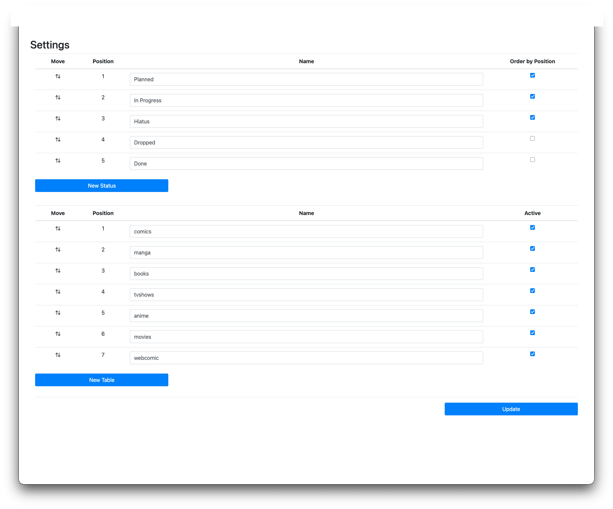
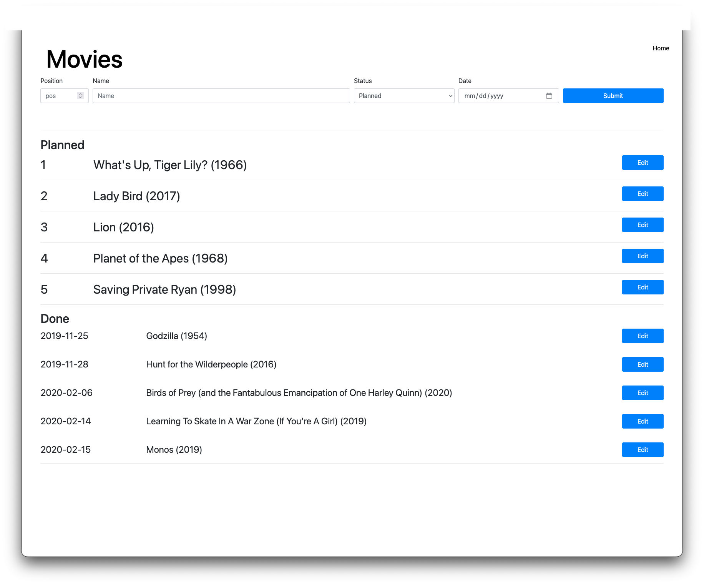
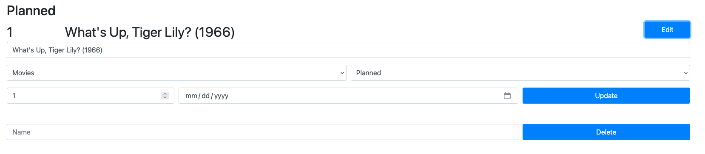
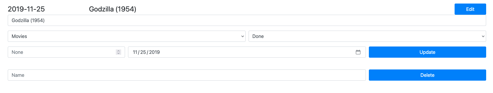

# PPF Checklist
The checklist is a way to track what you want to watch and when you watched something. It started
out just tracking comic book trades that I was working thru but now has expanded to movies, tv,
books, and anything else really.

## Installation
### Docker
```
docker run -d -v ./data:/usr/src/app/data -p 8080:80 ghcr.io/spslater/ppfchecklist
```

To build locally run `docker build -t "ppfchecklist" .` and `docker-compose.yml` is provided as a
sample compose file.

### Pip
```
pip install -r requirements.txt
```

## Upgrade
Upgrading from the TinyDB version of PPF Checklist just requires going to the `/upload` endpoint and selecting the old database. The tables will be in alphabetical order instead of the order assigned previously.

## Security / Users
The app is currently developed with no security whatsoever and is a single user application. Anyone
with access to it can delete everything with no confirmation. Use with caution.

## Usage
```python3 -m gunicorn --config config.py ppfchecklist:app```

PPF Checklist loads it's settings from environment variables set and the `config.py` file.

## Web Endpoints
Done items are displayed below the list, with dates completed next to it.

### '/health'
Will return a 200 status OK response if the server is up and running.

### '/download'
Download the database as a json file for backup.

### '/upload'
Upload a json of the database to insert new data or restore backup.

### '/': index
Displays all lists on a single page

### '/list/\<thing>': things
Only displays items for specific list named `thing`
Will automatically redirect to here if `/<thing>` is accessed because the old version of the app did
that and I still have that muscle memory.

### '/settings'
Reorder, rename, and add new statuses and `thing` tables.


## Editing
### Position
Can edit the position in the list. A postition of `0` indicates the item is completed.
A position of `-1` indicates it's been dropped.

### Names
Can edit the title / name of an entry.

### Movement
Can move items between 2 different lists. Useful if a new sublist is created
like going from `tvshows` to `animated` and `live action`.

### Delete
Can delete items from a list if no longer being tracked.


## Screenshots
### Settings Page


### List Page


### Editing Planned Item


### Editing Done Item


## Contributing
Help is greatly appreciated. First check if there are any issues open that relate to what you want
to help with. Also feel free to make a pull request with changes / fixes you make.

## License
[MIT License](https://opensource.org/licenses/MIT)


## Name
I cannot figure out what PPF is supposed to stand for. It must've made sense when I first came up
with it but now only God knows.
